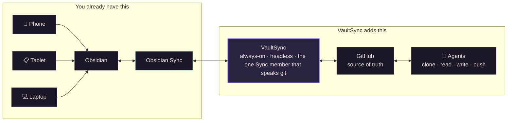

<div align="center">


# VaultSync

**Your Obsidian vault, on your phone and in the hands of an AI agent. At the same time.**

*One vault. Every device. Every agent. No copies, no drift, nothing to merge by hand.*

<br>

[](https://grok-obsidian.vercel.app)

[](daemon/test)
[](daemon/Dockerfile)
[](daemon/render.yaml)
[](daemon/Dockerfile)
[](#running-it)

<br>

**[Website](https://grok-obsidian.vercel.app)** · **[Setup runbook](docs/setup.md)** · **[Architecture](docs/architecture.md)** · **[Agent access](docs/agent-access.md)** · **[Tests](daemon/test)**

</div>

---

## The problem

An Obsidian vault is the best place to think. It is the worst place to collaborate with an
agent.

**Obsidian Sync** moves notes between *your devices* beautifully, and stops there. It has no
webhook, no API, no way for anything else to listen. **Git** moves notes between *machines
and agents* beautifully, and stops there too. Nothing on your phone speaks it.

Put a vault in git and your phone falls out of the loop. Keep it in Sync and every agent is
blind. You end up choosing which half of your life your notes live in.

VaultSync refuses the choice.



Edit a note on your phone in a lift. It is a commit before you reach the lobby. An agent
rewrites twenty notes at 3am; they are on your phone at breakfast. Nobody commits, nobody
opens a pull request, nobody merges.

<div align="center">

**Do not want to set this up by hand?** Answer three questions at
**[grok-obsidian.vercel.app](https://grok-obsidian.vercel.app)** and get a Grok Bot template,
or a prompt for Cursor / Claude Code / Codex, that installs and runs VaultSync for your vault.

</div>

---

## What you get

| | |
|---|---|
| **Real-time, both directions** | A phone edit is in git in seconds. A pushed note is on every device seconds later. |
| **Zero Git on your devices** | Your phone, tablet and laptop keep using Obsidian Sync exactly as they do today. |
| **Agents that can actually read your notes** | Any agent that can clone a repo can read, grep, write and push. No plugin, no MCP server, no special client. |
| **Conflicts the Obsidian way** | A genuine collision becomes a `Note (conflicted copy).md` inside the vault, on every device, with your version kept as the main note. |
| **Every version, forever** | Git history keeps every side of every edit. Nothing is thrown away, ever. |
| **Plugins and themes travel too** | `.obsidian/` is versioned and the daemon asks Sync to carry it, so a fresh device gets your setup. |
| **One container, no ports** | Outbound-only. Runs on a Bot VM for a session, a laptop you leave on, or a small always-on worker. |

---

## Why a daemon, and not something simpler

This is the question worth interrogating, so here is the honest answer.

Obsidian Sync has **no webhook and no server-side API**. The only way to learn that a note
changed is to *be a client with the connection open*. That is a process, and it has to be
awake when you are not, which rules out a cron, your laptop, and your phone.

The obvious alternative is the **Obsidian Git plugin**, and it was evaluated fairly rather
than dismissed. Its own maintainer currently describes it as *"very unstable"* on mobile and
says *"I would not recommend using this plugin on mobile"*, root-caused to `isomorphic-git`
loading whole packfiles into a mobile JS heap: an architectural ceiling rather than a bug
queue. Even if that were fixed tomorrow, the plugin is a **foreground UI trigger**: it cannot
sync while no Obsidian client is open, which is exactly the window that matters.

So: one small always-on process. That is the whole justification, and if Obsidian ever ships
a webhook, this project should delete itself.

---

## Design laws

These are not aspirations. They are enforced in code and covered by tests.

<details open>
<summary><b>Git is the source of truth.</b></summary>

Sync is a device transport, not the record. Every disagreement resolves toward git.
</details>

<details>
<summary><b>Conflicts resolve the way Obsidian Sync resolves them. Never worse, never silently destructive.</b></summary>

Sync's own default auto-merges concurrent edits, and so does the bridge: divergence between
git and the vault is resolved by a real merge, and edits to different parts of a note flow
together exactly as they would under plain Sync. A genuine same-region collision becomes an
Obsidian-style **"Note (conflicted copy …).md" committed into the vault**. It appears on your
devices, inside Obsidian, precisely where Sync's own conflicts appear, with your device's
version kept in the main note. Pushes are *never* forced, and git history keeps every side of
every conflict, so the safety net is strictly stronger than Sync's version history.
</details>

<details>
<summary><b>A silent daemon must be distinguishable from a working one.</b></summary>

Every reconcile pass is quiet on success, so logs alone could not tell a healthy bridge from a
wedged one. A periodic heartbeat prints the git-level state (`HEAD`, uncommitted count, poll
rate), and because `ob` has no health API, the bridge watches `ob`'s own narration and reports
how long it has been silent, warning past a threshold. That is the one failure mode that used
to be invisible: git syncing normally while devices quietly receive nothing.
</details>

<details>
<summary><b>Fail soft, and say so.</b></summary>

No credentials means idle, not crash. No Obsidian auth means git-only mode *with a warning*:
agents keep syncing, phone-only edits do not, and the log says which. Silence is never the
failure mode.
</details>

<details>
<summary><b>Nothing may block on a prompt.</b></summary>

Every `ob` call reads stdin from `/dev/null`. A missing credential fails in a second instead
of hanging invisibly forever.
</details>

<details>
<summary><b>Refuse rather than corrupt.</b></summary>

If the vault declares Git LFS filters and `git-lfs` is missing, the daemon exits. Committing
would write pointer files where your images should be, corruption you would discover months
later opening a broken note.
</details>

<details>
<summary><b>Fast, but debounced.</b></summary>

A local edit is picked up by `inotify` and reaches the remote in roughly 1-2 seconds. A burst
of continuous writes (Obsidian saves on every keystroke) is debounced into one commit. Remote
polling is adaptive: quick while there has been recent activity, backing off toward an idle
rate otherwise. If `inotify-tools` is ever missing at runtime, the daemon falls back to
interval-only polling with a WARNING rather than losing local-edit detection silently.
</details>

<details>
<summary><b>Never propagate a vault-emptying commit.</b></summary>

Anything that empties the working tree (a bad first-link reconciliation, a half-mounted
volume, a stray `rm`) used to be staged, committed and pushed within one poll, and from there
to every device. A pass that would delete most of the vault is now *held*, loudly, and
proceeds only if it is still there after a grace window. A real reorganisation persists; a
glitch does not.
</details>

<details>
<summary><b>Never commit past the Sync cap.</b></summary>

Obsidian Sync (Standard plan) refuses files over 5MB. A file that size committed via git would
reach the repo but never reach a device: silent divergence. The daemon refuses to commit an
oversize file (unstaging it, not deleting it) and warns every pass until it is resolved.
Opt-in image compression (`VAULT_COMPRESS_IMAGES`) can shrink oversized images to fit instead;
it is the one place the daemon rewrites your files, and it is off by default.
</details>

---

## Running it

Outbound-only. No ports, no inbound HTTP, no health endpoint to serve. It runs anywhere with
a persistent volume at `/data`.

```bash
docker build -t vaultsync ./daemon
docker run -d --name vaultsync --restart unless-stopped \
  -v vaultsync-data:/data \
  -e VAULT_REPO="https://<token>@github.com/you/your-vault.git" \
  -e OBSIDIAN_AUTH_TOKEN="..." \
  -e VAULT_SYNC_REMOTE="Your Vault" \
  -e VAULT_SYNC_ENCRYPTION_PASSWORD="..." \
  vaultsync
docker logs -f vaultsync
```

It is running when both of these lines appear, with no `WARNING`s:

```
[vault-bridge:<name>] reconcile loop: adaptive poll ...
Device name: vault-bridge-<name>
```

| Where | When to choose it | How |
|---|---|---|
| **A Grok Bot / Cloud Agent VM** | Prove the loop in one session. Stops when the session does. | The [website](https://grok-obsidian.vercel.app) writes the Bot the paste for this. |
| **A machine you leave on** | Free, runs overnight, survives reboots via `--restart unless-stopped`. | The `docker run` above. |
| **A hosting provider** | Always on, nothing of yours has to stay on. | [`daemon/render.yaml`](daemon/render.yaml) provisions a Render background worker; Fly.io, Railway or any VPS with Docker work the same way. See [`docs/moving-hosts.md`](docs/moving-hosts.md). |

**State lives on the disk and must stay there.** The auth token and each vault's `state.db`
live in one shared `XDG_CONFIG_HOME` (default `/data/ob-state`). Lose it and you force a full
re-sync; commit it and you leak credentials into your notes.

---

## Configuration is the enablement

There is no manifest and no `enabled` flag to keep in sync with anything. **A vault exists
because its config does.**

**One vault**: set `VAULT_REPO` as a plain environment variable. Done.

**Several vaults**: indexed identifier variables, where **the repo URL is the identity**
(git is the source of truth, so the repo link names the vault):

```
VAULT_1=https://github.com/you/PlanningVault.git
VAULT_1_SYNC_REMOTE=Planning
VAULT_1_SYNC_ENCRYPTION_PASSWORD=...
VAULT_2=https://github.com/you/PersonalVault.git
...
```

The local name derives from the repo basename (`PlanningVault` → `planningvault`;
`VAULT_n_NAME` overrides). Indices tolerate gaps: deleting `VAULT_2` never renumbers
`VAULT_3`. One env group defines the whole service.

### Adding a vault is three things, not one

1. Its config keys (repo URL, Sync remote name).
2. **Extending `GIT_TOKEN` to the new repo.** Fine-grained PATs enumerate repositories
   explicitly; a newly created repo is *never* covered by an existing token.
3. **Its encryption password**, if the new Sync remote is end-to-end encrypted.

The daemon catches the half-done states instead of half-working: a name listed with no
repo key warns loudly at boot (`HALF-ADDED`), a `REPLACE_ME` placeholder anywhere in a
vault's config is fatal with a message naming the fix, and a clone failure hints at PAT
coverage rather than leaving a bare auth error.

Every key, each with a comment explaining why it exists:
[`daemon/secrets.example/vault-planning.env`](daemon/secrets.example/vault-planning.env).

### Authentication

Use **`OBSIDIAN_AUTH_TOKEN`**. The headless client reads it straight from the environment, so
the daemon never runs a login, which means **account MFA is simply irrelevant**. Get it by
running `ob login` once anywhere and reading
`${XDG_CONFIG_HOME:-~/.config}/obsidian-headless/auth_token`.

If your remote vault is end-to-end encrypted, `VAULT_SYNC_ENCRYPTION_PASSWORD` is **required**.
Obsidian's E2E is zero-knowledge: the server never sees it, so no account token can derive it.
Omit it and `ob sync-setup` prompts, and a prompt in a background worker is an invisible hang.

### Install the vault's `.gitignore` first

Do this before the first sync, not after. Copy
[`daemon/vault.gitignore.example`](daemon/vault.gitignore.example) into the root of your
**vault content repo**. Without it, per-device UI churn and Obsidian Sync's own conflict
copies get committed on the very first pass and are then permanent in your history.

It deliberately does *not* ignore `.obsidian/` wholesale: your plugin and theme declaration
is real configuration worth versioning, and agents are meant to be able to change it.

---

## Repository layout

```
.
├── daemon/            the container: Dockerfile, entrypoint, bridge.sh, render.yaml
│   ├── secrets.example/   every configuration key, annotated
│   └── test/              behavioural test suite (real git, real entrypoint)
├── docs/              runbook, architecture, agent access, isolation, moving hosts
└── vault-seeds/       starting trees for a new vault: .gitignore, agent rules, memory log
```

---

## Tests

```bash
bash daemon/test/run.sh
```

They are **behavioural**. They run the real entrypoint and the real daemon against real git
repositories and assert on what actually happened: that edits move in both directions, that a
divergence is surfaced rather than force-pushed, that git-only degradation is announced, that
a stray global variable cannot collapse every vault onto one repo, that a local edit reaches
the remote in seconds via `inotify` (falling back cleanly when it is absent), that a burst of
continuous writes debounces into one commit, and that a file over the Sync cap is withheld and
warned about while its siblings still sync. Nothing greps the source, so a rename cannot fake
a pass and inverted logic cannot slip through.

Conflict resolution is tested against a **hand-built conflicted index**, both directions of a
modify/delete, rather than by racing the daemon: a timing-based version of that test silently
stopped constructing the conflict and passed against known-broken code. If a test here cannot
be shown to fail against the bug it names, it is not yet a test.

---

## Status

| Component | State |
|---|---|
| **Sync daemon** | Built, tested (74/74), validated against `obsidian-headless` 0.0.14 |
| **Agent access skill** | Built and cold-start verified (the `use` skill, seeded into the vault) |
| **Live deployment** | Live, two vaults bridged end to end |
| **Guided setup** | [grok-obsidian.vercel.app](https://grok-obsidian.vercel.app): three questions, then a Grok Bot template or an agent prompt that installs this repo |

The daemon pins `obsidian-headless` by version on purpose. It is a `0.0.x` open beta whose
CLI has already changed shape between releases; three separate bugs in an earlier
implementation came from guessing at its interface instead of reading it. Re-check `ob --help`
before bumping.

---

## Documentation

| Document | What it answers |
|---|---|
| [`docs/setup.md`](docs/setup.md) | The full setup runbook: the owner pastes four values, an agent does the rest |
| [`docs/architecture.md`](docs/architecture.md) | How the pieces fit, and what would make this design wrong |
| [`docs/agent-access.md`](docs/agent-access.md) | How an agent reads a vault, and why there is no MCP server |
| [`docs/isolation.md`](docs/isolation.md) | How a vault carries its own rules and skills without infecting other projects |
| [`docs/moving-hosts.md`](docs/moving-hosts.md) | Moving a vault or the whole daemon to another hosting account |
| [`docs/obsidian-link-semantics.md`](docs/obsidian-link-semantics.md) | What it actually takes to resolve `[[wikilinks]]` the way Obsidian does |
| [`daemon/README.md`](daemon/README.md) | Operator notes: which transport carries `.obsidian/`, dotfolder conflicts, image compression |
| [`vault-seeds/README.md`](vault-seeds/README.md) | Seeding a brand-new vault repo |

<div align="center">
<br>

Built for people who think in Obsidian and work with agents.
**[Set it up in three minutes →](https://grok-obsidian.vercel.app)**

</div>
